<div align="center">
  

  <h1>Gronify</h1>

  <p><strong>Grep multi-gigabyte JSON &amp; JSONL in constant memory — no <code>jq</code> syntax, no <code>grep</code> required.</strong></p>

  <p>
    <a href="https://gronify.vercel.app/playground"><strong>Try Live Playground</strong></a> ·
    <a href="https://gronify.vercel.app">Docs &amp; Guides</a> ·
    <a href="https://www.npmjs.com/package/gronify">npm</a> ·
    <a href="https://skills.sh/1solomonwakhungu/gronify">AI Agent Skills</a> ·
    <a href="https://github.com/1solomonwakhungu/gronify/blob/main/src/packages/cli/BENCHMARKS.md">Benchmarks</a>
  </p>

  <p>
    <a href="https://github.com/1solomonwakhungu/gronify/actions/workflows/quality-check.yaml"></a>
    <a href="https://www.npmjs.com/package/gronify"></a>
    <a href="https://www.npmjs.com/package/gronify"></a>
    <a href="https://skills.sh/1solomonwakhungu/gronify"></a>
    <a href="https://github.com/1solomonwakhungu/gronify/blob/main/LICENSE"></a>
  </p>
</div>

Gronify flattens nested JSON and JSON Lines (NDJSON) into one `json.path = value` line per value, searches them with plain text or JavaScript regex in a single streaming pass, and rebuilds filtered lines back into JSON (`unflatten`). Runs on **macOS, Linux, and Windows** via `npm`/`npx` or Homebrew (Node.js 20+).

<p align="center">
  
</p>

```bash
npx gronify search payload.json "error"   # zero-install run (Node.js 20+)
npm install -g gronify                    # or install globally
brew install 1solomonwakhungu/tap/gronify # or via Homebrew
```

---

## Why Gronify instead of `gron`, `fastgron`, or `jq`?

Every command (`flatten`, `search`, `unflatten`) is a **byte-level stream**. It never loads the whole file into memory, never hits Node's `ERR_STRING_TOO_LONG` ceiling, and stops reading immediately once a result cap (`-m` / `--limit`) is reached.

Measured on an Apple M5 Pro (Node v22.23.1, 8 GiB memory guard, 60 s timeout — full methodology and raw receipts in [BENCHMARKS.md](https://github.com/1solomonwakhungu/gronify/blob/main/src/packages/cli/BENCHMARKS.md)):

| Workload                      | **gronify**                   | `gron` (Go)              | `fastgron` (C++)                    | `jq --stream`      |
| :---------------------------- | :---------------------------- | :----------------------- | :---------------------------------- | :----------------- |
| **Flatten 1 GiB JSON**        | **3.63 s / 65 MiB**           | Killed (OOM >8 GiB)      | **1.78 s** / 1.85 GiB               | 55.7 s / 3 MiB     |
| **Unflatten 2.24 GiB gron**   | **5.10 s / 97 MiB**           | Killed on 10 MB (>8 GiB) | 6.10 s / 7.46 GiB                   | Unsupported        |
| **First 10 matches in 1 GiB** | **0.03 s / 52 MiB** (`-m 10`) | Killed (OOM >8 GiB)      | 0.39 s / 1.85 GiB (`\| grep -m 10`) | **0.02 s / 3 MiB** |
| **50,000 levels deep**        | **0.06 s / 55 MiB**           | Failed (max depth)       | Failed (segfault)                   | Timeout (>60 s)    |

**Be honest about trade-offs:**

- Pick **`jq`** when you already know the schema and need to reshape, map, or compute new JSON.
- Pick **`fastgron`** when raw single-pass flatten or fixed-string (`-F`) throughput on files that fit in RAM matters most.
- Pick **`gron`** if you want a standalone Go binary with URL fetching and sorted output by default.
- Pick **Gronify** when you want **constant-memory streaming on multi-GB JSON/JSONL (both directions)**, **built-in regex + early-stop caps (`-m`, `--limit`, `--count`, `--exit-status`)**, **AI coding agent safety**, or **`npx` / Windows PowerShell** support with no `grep` required.

---

## Demo

A 30-second tour of the core workflows (or try them directly in the [Live Playground](https://gronify.vercel.app/playground)):

### 1. Find paths in unfamiliar or minified JSON

```bash
gronify search service.json --regex "status|version"
# json.service.status = "degraded"
# json.deployments[0].version = "2026.05.22"
# json.deployments[1].version = "2026.05.21"
```

### 2. Explore multi-GB files without blowing up your terminal (or LLM context)

```bash
gronify search huge.json --count "timeout"        # 1. count matches first
gronify search huge.json -m 10 "timeout"          # 2. first 10 matches, then stop reading
gronify flatten --limit 40 huge.json              # 3. inspect document shape only
```

### 3. Search JSON Lines / NDJSON logs (`-s`, `--stream`, `--jsonl`)

```bash
gronify search --jsonl app.jsonl -m 20 '.level = "error"'
tail -n 1000 app.jsonl | gronify search -s --regex '\.level = "(error|warn)"'
```

### 4. Filter and rebuild valid JSON (`unflatten`)

`unflatten` synthesizes missing parent objects and arrays automatically and streams in a single pass:

```bash
gronify search service.json version | gronify unflatten
# {"deployments":[{"version":"2026.05.22"},{"version":"2026.05.21"}]}
```

### 5. Compare two JSON files with `diff` (`--sort`)

```bash
diff <(gronify flatten --sort old.json) <(gronify flatten --sort new.json)
```

### 6. Branch in CI & shell scripts (`--exit-status`, `-o`)

```bash
# Exit 0 = match, 1 = no match, 2 = error (like grep)
if gronify search --exit-status config.json -m 1 'debug = true' >/dev/null 2>&1; then
  echo "debug is enabled"
fi

# Atomic file output: temp file renamed only on full success
gronify -o restored.json unflatten archive.gron
```

---

## Use with AI Coding Agents (Claude Code, Codex, Cursor)

Stop coding agents from reading 50 MB `package-lock.json` files, OpenAPI specs, or JSONL transcripts whole into context. Install the Gronify agent skills suite via [skills.sh](https://skills.sh/1solomonwakhungu/gronify):

```bash
npx skills add 1solomonwakhungu/gronify
# or preview / install a single skill
npx skills add 1solomonwakhungu/gronify --list
npx skills add 1solomonwakhungu/gronify --skill gronify-json-flatten-search
```

| Skill                                                                                                       | Focus                                                                                         |
| :---------------------------------------------------------------------------------------------------------- | :-------------------------------------------------------------------------------------------- |
| [`gronify-json-flatten-search`](https://skills.sh/1solomonwakhungu/gronify/gronify-json-flatten-search)     | Complete Gronify CLI workflow: flatten, search, JSONL, `--sort`, exit codes, and `unflatten`  |
| [`large-json-search`](https://skills.sh/1solomonwakhungu/gronify/large-json-search)                         | Context-safe exploration of >50 KB, minified, compressed, or multi-GB JSON files              |
| [`jsonl-ndjson-log-search`](https://skills.sh/1solomonwakhungu/gronify/jsonl-ndjson-log-search)             | Streaming `.jsonl` / `.ndjson` log and transcript search with `--jsonl` / `-s`                |
| [`json-compare-sorted-diff`](https://skills.sh/1solomonwakhungu/gronify/json-compare-sorted-diff)           | Key-order-independent JSON comparison with `flatten --sort`, system `diff`, and `git diff`    |
| [`openapi-lockfile-json-search`](https://skills.sh/1solomonwakhungu/gronify/openapi-lockfile-json-search)   | Path-anchored recipes for OpenAPI/Swagger specs, `package-lock.json`, `kubectl`, and AWS JSON |
| [`json-path-to-jq-and-unflatten`](https://skills.sh/1solomonwakhungu/gronify/json-path-to-jq-and-unflatten) | Find JSON paths for `jq` / JSONPath, keep 64-bit numbers exact, and unflatten subsets         |

---

## Requirements

- Node.js 20 or newer.
- npm 10 or newer (when installing via npm or building from source).

## Install

```bash
npm install -g gronify                    # npm (global)
npx gronify --help                        # zero-install via npx
brew install 1solomonwakhungu/tap/gronify # Homebrew (installs Node.js dependency too)
```

- **Release archives:** Download `gronify-vX.Y.Z.tar.gz` or `.zip` (with `checksums.txt`) from [GitHub Releases](https://github.com/1solomonwakhungu/gronify/releases).
- **From source:** See [Development](#development) below.

---

## Run

### Global Options

| Option                         | Description                                                                                    |
| :----------------------------- | :--------------------------------------------------------------------------------------------- |
| `--color` / `--no-color`       | Force or disable colored output (auto-detected on TTY; disabled with `-o`).                    |
| `--pretty`                     | Indent and group `flatten` output by path depth, or pretty-print `unflatten` (`2`-space JSON). |
| `-o, --output <file>`          | Write atomically to a file (replaces target only on success; safe for in-place `-o`).          |
| `-h, --help` / `-V, --version` | Show help or CLI version.                                                                      |

### `gronify flatten [file]`

Flatten JSON from a file or stdin into `json.path = value` lines in document order.

| Option                    | Description                                                                          |
| :------------------------ | :----------------------------------------------------------------------------------- |
| `--limit <n>`             | Stop after `n` lines and immediately stop reading input.                             |
| `--sort`                  | Sort object keys at every level (UTF-16 order) while keeping array indexes in order. |
| `-s, --stream`, `--jsonl` | Read JSON Lines / NDJSON as `json[0]`, `json[1]`, ... under `json = []`.             |

### `gronify search <file_or_term> [term]`

Flatten and filter in one streaming pass (case-insensitive substring match on the full `path = value` line by default). Omit the file argument when reading from stdin.

| Option                    | Description                                                               |
| :------------------------ | :------------------------------------------------------------------------ |
| `-r, --regex`             | Match using a JavaScript regular expression.                              |
| `-c, --case-sensitive`    | Match exact letter case.                                                  |
| `--count`                 | Print only the total match count.                                         |
| `-v, --invert-match`      | Print lines that do not match.                                            |
| `-m, --max-count <n>`     | Stop after `n` matches (or non-matches with `-v`) and stop reading input. |
| `--sort`                  | Sort matching lines by object key (ignored with `--count`).               |
| `--exit-status`           | Exit `0` on match, `1` on no match, `2` on error.                         |
| `-s, --stream`, `--jsonl` | Read JSON Lines / NDJSON.                                                 |

### `gronify unflatten [file]`

Rebuild gron lines (from `gronify`, `gron`, or `fastgron`) back into JSON in a streaming pass. Missing root/parent containers from filtered output are synthesized automatically, and skipped array indexes become `null`.

---

## Key Guarantees

- **Exact numbers:** `12345678901234567890`, `1.10`, `1e-7`, and `-0` are validated and preserved verbatim through `flatten`, `search`, and `unflatten`—never rounded through IEEE-754 floats like `JSON.parse()`.
- **Strict JSON errors:** Reports exact byte offset, line, and column (e.g. `Unexpected '}' after ',' at byte offset 7 (line 1, column 8)`). Trailing commas, comments, and single quotes are rejected.
- **Cross-platform CI:** Tested on Linux, macOS, and Windows (Node.js 20 and 22). No `grep`, `awk`, or native compiler required.
- **100% local:** Makes zero network requests and collects zero CLI telemetry.

<details>
<summary><strong>Deep Dive: Streaming limits, <code>--sort</code> memory, JSONL rules, and exit codes</strong></summary>

- **Streaming & early caps:** Input reads in 1 MiB blocks from files (64 KiB from stdin). With `-m` or `--limit`, Gronify destroys the input stream on hit, exits `0`, and prints a one-line notice to `stderr` (`Stopped after 20 matches (--max-count); there may be more`) so `stdout` stays clean. Everything after the cap is not read or validated.
- **Invalid input on stdout:** Because output streams as bytes arrive, check the exit code (or use `set -o pipefail`) when piping untrusted/truncated files, or use `-o <file>` for atomic writes.
- **`--sort` behavior & memory:** Keys sort by UTF-16 code unit (JS `sort()` order), keeping subtrees contiguous and arrays in index order. Top-level arrays stream one record at a time. Root objects buffer up to `64 MiB` (configurable via `GRONIFY_SORT_MEMORY`, e.g. `256MiB`) before spilling to an unlinked temp file in `$TMPDIR`. Unlike `gron`, Gronify keeps document order by default and does not merge duplicate keys.
- **JSON Lines (`-s` / `--stream` / `--jsonl`):** One JSON value per line; blank lines and `\r\n` are skipped; empty input prints `json = []` and exits `0`. `gronify flatten -s logs.jsonl | gronify unflatten` yields a JSON array (pipe through `jq -c '.[]'` if you need JSONL back).
- **`unflatten` ordering:** Document-order gron streams in one pass. Out-of-order gron (e.g. plain `sort` output) is rebuilt in memory if detected within the first `16 MiB` of input/output; beyond that it fails with the offending line number. Colored `unflatten` buffers the full document—pass `--no-color` on huge files.
- **Exit codes:** Default `0` = success (including 0 search matches), `1` = error. With `search --exit-status`: `0` = matched, `1` = no match, `2` = error. Closed pipes (`| head`) exit `0`.

</details>

---

## Task Guides

Detailed walkthroughs with verified transcripts are on [gronify.vercel.app/guides](https://gronify.vercel.app/guides):

- [Interactive Browser Playground](https://gronify.vercel.app/playground) (no install, up to 2 MB in-browser)
- [How to grep JSON from the command line](https://gronify.vercel.app/guides/grep-json) · [Windows PowerShell & cmd](https://gronify.vercel.app/guides/grep-json-windows-powershell)
- [Search large JSON files](https://gronify.vercel.app/guides/large-json-files) · [Fix Node.js `ERR_STRING_TOO_LONG`](https://gronify.vercel.app/guides/fix-err-string-too-long-json)
- [Search OpenAPI specs, `package-lock.json`, and Kubernetes JSON](https://gronify.vercel.app/guides/search-openapi-and-lockfiles)
- [Gronify vs `gron` & `fastgron`](https://gronify.vercel.app/guides/gron-alternative) · [Gronify vs `jq`](https://gronify.vercel.app/guides/jq-alternative)
- [JSON exploration for AI coding agents](https://gronify.vercel.app/guides/json-for-ai-agents) · [Compare JSON files with `diff`](https://gronify.vercel.app/guides/compare-json-files)
- [Unflatten gron output](https://gronify.vercel.app/guides/unflatten-json) · [Keep 64-bit integers exact](https://gronify.vercel.app/guides/json-number-precision)

---

## Development

The CLI package lives in `src/packages/cli`:

```bash
git clone https://github.com/1solomonwakhungu/gronify.git
cd gronify/src/packages/cli
npm ci
npm run build
npm test          # runs integration tests directly against dist/index.js
npm link          # optional: link local `gronify` binary
```

Useful scripts inside `src/packages/cli`:

- `npm run lint` / `npm run format:check` / `npm run audit`
- `npm run bench` — synthetic flatten/search/sort/early-exit benchmark
- `npm run bench:compare` — full cross-tool benchmark against `gron`, `fastgron`, `jq`, and `jaq` (regenerates `BENCHMARKS.md` and `landing-page/src/app/benchmark-results.json`)

```text
branding/          Logo, icons, and animated demo.svg
docs/              Benchmark receipts and review notes
landing-page/      Next.js docs, guides, and /playground
skills/            Installable agent skills suite (6 skills indexed by skills.sh)
skills.sh.json     Repository skill groupings for skills.sh
src/packages/cli/  TypeScript streaming CLI package
```

## Troubleshooting

- **`npm test` fails before running assertions:** Run `npm run build` first so `dist/index.js` exists.
- **JSON fails to flatten:** Gronify requires strict JSON (no trailing commas, comments, or single quotes) and one document per run. For JSON Lines / NDJSON, pass `-s`, `--stream`, or `--jsonl`.
- **`unflatten` reports `property does not match its parent container`:** Two lines assign conflicting types to the same path (e.g. `json.a = 1` then `json.a.b = 2`, or mixing object keys and array indexes). Missing parent lines are synthesized automatically in `1.4.0+`.

## Contributing

See [CONTRIBUTING.md](https://github.com/1solomonwakhungu/gronify/blob/main/CONTRIBUTING.md) for the development workflow and pull request expectations.

## Security

See [SECURITY.md](https://github.com/1solomonwakhungu/gronify/blob/main/SECURITY.md) for vulnerability reporting guidance.

## License

Gronify is licensed under the [MIT License](https://github.com/1solomonwakhungu/gronify/blob/main/LICENSE). Inspired by [tomnomnom/gron](https://github.com/tomnomnom/gron); CLI parsing and color powered by [commander.js](https://github.com/tj/commander.js) and [chalk](https://github.com/chalk/chalk).
